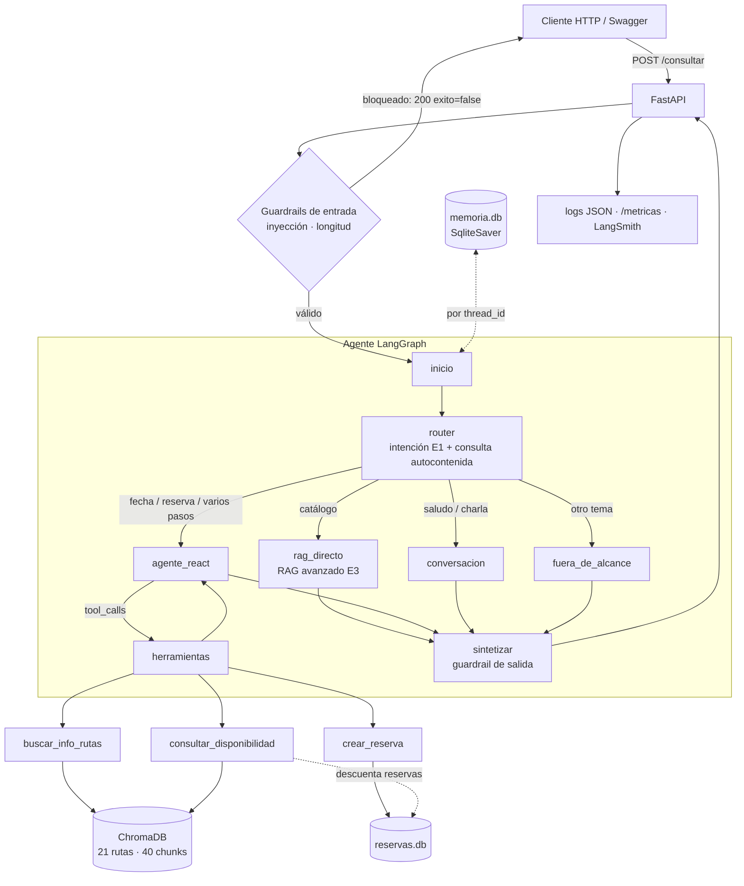

# Ficha técnica — Smart Flight Assistant (TP Final)

| | |
|---|---|
| **Sistema** | Agente conversacional de vuelos sobre un catálogo de 21 rutas aéreas europeas |
| **Qué resuelve** | Responde preguntas del catálogo, consulta disponibilidad y precios de una fecha y crea reservas, recordando cada conversación |
| **Equipo** | Chiara Vallone, Nicolás Diego Diddi, Gino Frigoni, Jorge Alonso, Joaquín Darquier |
| **Versión** | 1.0.0 — noviembre 2026 |
| **Stack** | Python 3.11–3.13 · LangGraph 1.2 · LangChain 1.x · ChromaDB 1.5 · FastAPI 0.162 · SQLite · LangSmith |

## Arquitectura

## Componentes

| Componente | Decisión | Valor |
|---|---|---|
| LLM | `gpt-4o-mini`, temperatura 0 | timeout 30 s por llamada, 2 reintentos |
| Embeddings | `text-embedding-3-small`, distancia coseno | umbral de aceptación 0.50 (E2) |
| Base de conocimiento | ChromaDB persistente, purgada por ETL (E2) | 21 rutas → 40 chunks de 500/100 caracteres (E3) |
| Retriever | RAG avanzado de la E3: 8 candidatos → juez LLM 0–10 → top 3 con puntaje ≥ 6 | escape decidido por código si no queda contexto; prompt de la E3 con la regla 4 adaptada (el agente sí reserva) |
| Router | salida estructurada: 5 intenciones de la E1 + `conversacion`, 2 booleanos y la consulta reescrita | el camino lo elige el código, no el LLM |
| Nodo ReAct | `bind_tools` con las 3 herramientas | máximo **5 iteraciones** (la última sin herramientas) + `recursion_limit` 25 |
| Memoria | `SqliteSaver` en `data/runtime/memoria.db`, un hilo por `thread_id` | al modelo le llegan los últimos 24 mensajes; los turnos de un mismo `thread_id` se atienden de a uno (lock por conversación) |
| API | FastAPI + uvicorn; el agente corre en un hilo aparte (`asyncio.to_thread`) | timeout de consulta 90 s → HTTP 504 |

## Herramientas

| Herramienta | Tipo | Entrada | Salida | Efecto |
|---|---|---|---|---|
| `buscar_info_rutas` | Conocimiento (RAG E3) | consulta autocontenida | respuesta citada `[RUTA-XXX-YYY]` o frase de escape | ninguno |
| `consultar_disponibilidad` | **Sensor** | origen, destino (IATA), fecha AAAA-MM-DD | JSON con vuelos: `flight_id`, aerolínea, hora, escalas, precio, asientos | lee la ruta en ChromaDB y las reservas existentes |
| `crear_reserva` | **Actuador** | `flight_id`, nombre, documento, email opcional | código `SFA-XXXXXX` o `Error: ...` | inserta en `reservas.db` y ocupa un asiento (conteo + inserción en una transacción: no sobrevende) |

El sensor simula la oferta del día de forma **determinista**: usa una semilla por ruta y fecha, a partir de la categoría de precio, de si hay vuelo directo y de las aerolíneas de la ficha. Aplica un recargo por compra con menos de 7 días o por vuelo en viernes/domingo. Los asientos reflejan las reservas reales del actuador.

## Endpoints

| Método y ruta | Respuesta | Códigos |
|---|---|---|
| `GET /health` | `status`, `sistema_activo`, chequeos (catálogo, SQLite, clave OpenAI, LangSmith) | 200 · 503 |
| `POST /consultar` | `respuesta`, `thread_id`, `herramientas_usadas`, `exito`, `bloqueado`, `motivo_bloqueo`, `intencion`, `camino`, `latencia_ms`, `request_id` | 200 · 422 · 500 · 504 |
| `GET /estado/{thread_id}` | `mensajes` [{`rol`, `contenido`}] enmascarados, `cantidad_mensajes`, última intención y camino | 200 · 404 |
| `GET /metricas` | consultas (exitosas/fallidas/bloqueadas), tasa de error, latencia prom./p95/p99/máx., herramientas, caminos, bloqueos por motivo, datos enmascarados, tokens, costo, alertas | 200 |

## Seguridad (guardrails)

| Capa | Validador | Qué hace |
|---|---|---|
| Entrada | `validar_longitud` | rechaza vacío o más de 1.500 caracteres |
| Entrada | `detectar_inyeccion` | 16 patrones en español e inglés, sobre el texto sin tildes, que apuntan a las instrucciones **del asistente** (no a cualquier palabra parecida): ignorar u olvidar sus reglas, cambio de rol ("a partir de ahora sos…", "tu nuevo rol es…"), pedir o copiar textual el prompt, falsas instrucciones (`[SYSTEM]`, `<system>`, `SYSTEM:` al inicio), modo desarrollador, "respondé sin restricciones" |
| Salida | `enmascarar_pii` | email, teléfono, tarjeta, IBAN, documento/pasaporte/DNI (el valor tiene que tener dígitos: "documento de identidad" no se toca) y nombre anunciado. Además oculta los **valores exactos** que recibió el actuador (nombre, documento, email del pasajero). Se aplica en la respuesta, en la memoria, en `/estado` y en los logs |

Lo bloqueado nunca llega al LLM (costo cero) y responde 200 con `exito=false`, sin revelar qué regla lo frenó. La suite `security_tests.py` tiene **54 tests** y corre con solo `pytest` desde la raíz: 51 deterministas (ataques, 12 consultas legítimas que se parecen a un ataque y no deben bloquearse, frases del agente que no deben enmascararse, integración con la API y concurrencia) y 3 contra el LLM real. Todos pasan.

## Observabilidad

- **Logs JSON** (consola y `data/runtime/api.log`, rotativo): eventos `request_completado`, `consulta_iniciada`, `consulta_completada`, `consulta_bloqueada`, `consulta_timeout`, `consulta_fallida`, `alertas_activas`. Llevan `request_id`, `thread_id`, duración, camino, herramientas, tokens y costo. El texto del usuario nunca se loguea crudo.
- **Métricas** en `/metricas`: un contador global con lock. Las latencias se toman solo de las consultas procesadas (p95/p99 por rango más cercano). Alertas si el p95 supera 15 s o la tasa de error supera 5%.
- **Trazas** en LangSmith: un run raíz `consulta_smart_flight` (tag `entrega_4`) por consulta, con cada nodo, herramienta y llamada al LLM. `analisis_costos.py` las agrupa por camino.

## Rendimiento y costo (LangSmith, 105 consultas reales)

| Camino | Tokens prom. | Costo por 1.000 consultas | Latencia prom. | p95 |
|---|---:|---:|---:|---:|
| `fuera_de_alcance` | 732 | US$ 0.13 | 1.3 s | 2.4 s |
| `conversacion` | 1.031 | US$ 0.18 | 6.2 s | 14.1 s |
| `rag_directo` | 2.729 | US$ 0.51 | 9.6 s | 18.8 s |
| `agente_react` | 4.280 | US$ 0.60 | 9.6 s | 25.1 s |

El costo promedio es **US$ 0.00047 por consulta**. La caché de prompts de OpenAI lo bajó un 12% respecto del precio de lista.

## Calidad

| Evaluación | Resultado |
|---|---|
| Matriz de validación (`resultados_matriz.md`) | **22/22**: catálogo, sensor, reserva en 3 turnos, fuera de alcance, memoria por `thread_id` y límite de iteraciones |
| RAGAS del retriever (E3, RAG avanzado, sin escape) | Faithfulness 0.863 · Answer Relevancy 0.855 · Context Precision 1.000 · Context Recall 1.000 |
| Suite de seguridad | 54/54 |
| Memoria tras reinicio del servidor | verificada: evidencia en `resultados/resultados_reinicio.md` (`python main.py verificar --paso1/--paso2`) |
| Instalación en máquina limpia | verificada con Python 3.12 siguiendo solo el README: base reconstruida (21 rutas, 40 chunks), `python main.py verificar` 6/6 y suite 54/54 |

## Limitaciones conocidas

- **Una sola instancia.** `SqliteSaver` vive en un archivo local y el lock que ordena los turnos de una conversación es del proceso. Para escalar con varias réplicas, la memoria tiene que pasar a PostgreSQL o Redis (y el lock, a uno distribuido). Las reservas sí son seguras entre procesos: la transacción la garantiza SQLite.
- **Las métricas se reinician** con el proceso (están en memoria). La historia completa queda en los logs y en LangSmith.
- **Disponibilidad simulada.** El sensor no consulta aerolíneas reales, y las reservas no cobran.
- **Los guardrails de inyección son patrones.** Bloquean los ataques conocidos, pero una paráfrasis nueva puede pasar. Como segunda línea están las reglas del prompt y el diseño: el usuario no puede cambiar las herramientas ni el código.
- **El timeout no corta el trabajo.** Si se dispara, la API responde 504, pero el hilo del agente puede terminar después y guardar su respuesta en la memoria.
- **No hay autenticación.** Cualquiera que conozca un `thread_id` puede leer su `/estado` (enmascarado).
- **Python 3.14 no está soportado** por `ragas` (dependencia de la Entrega 3).
